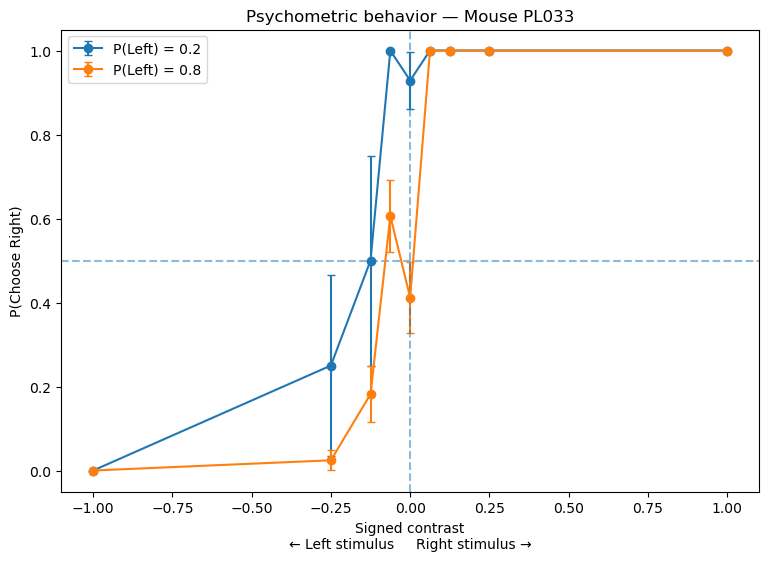
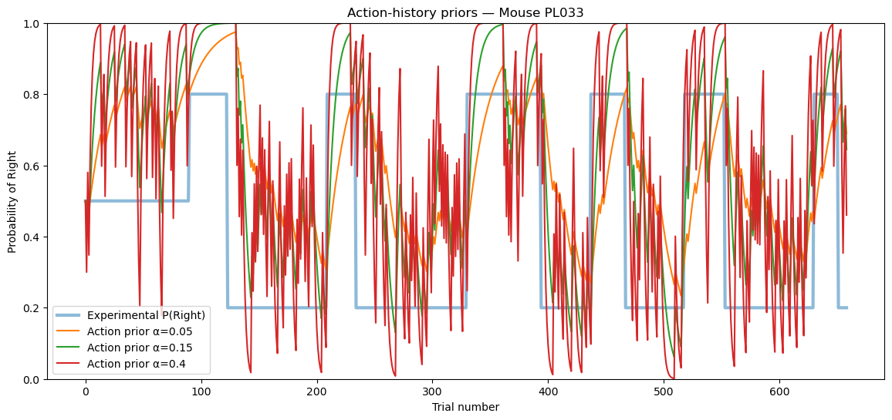
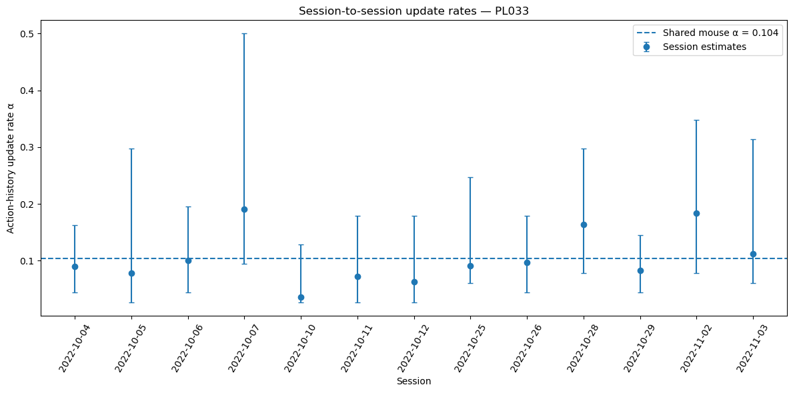
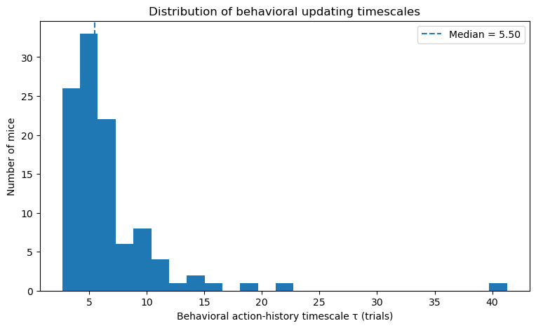
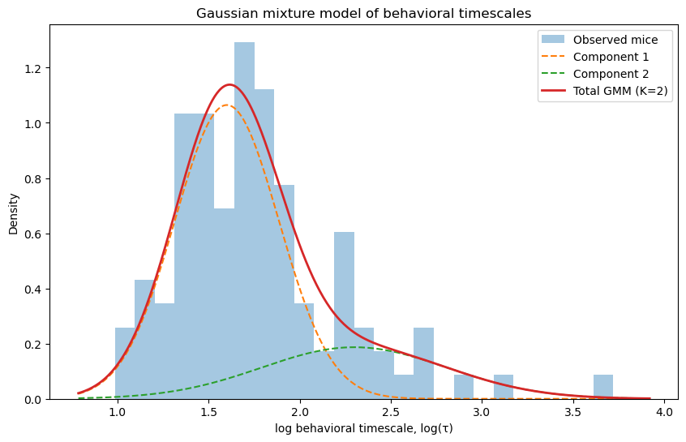
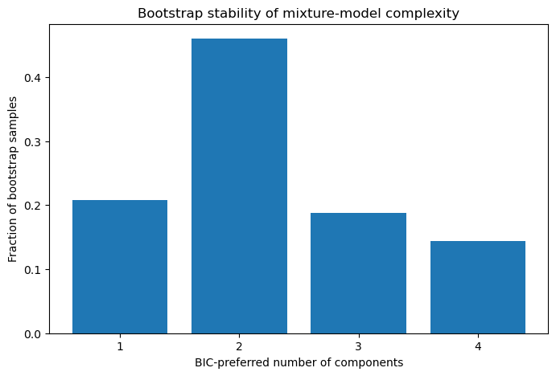

# Individual Differences in Bayesian Prior Updating Across Mice

**How quickly does each mouse update its expectations from past choices — and do mice fall into discrete "fast" and "slow" updater types, or vary along a continuum?**

A project from [Neuromatch Academy: Computational Neuroscience](https://compneuro.neuromatch.io/), using open behavioral data from the [International Brain Laboratory (IBL) Brain-Wide Map](https://www.internationalbrainlab.com/brainwide-map).

📓 **[Read the notebook → `IBL_BWM_Prior_Update_Project.ipynb`](IBL_BWM_Prior_Update_Project.ipynb)**
All outputs are saved in the notebook, so it can be read directly on GitHub without running anything.

---

## TL;DR

* An action-kernel model of the subjective prior was fitted to **107 mice** from the IBL Brain-Wide Map (every mouse with at least two sessions); 106 passed quality control.
* Mice differ substantially in how fast they update: **τ ranges from 2.7 to 41 trials** (median 5.5 trials, in close agreement with the 5.45 trials reported by Findling et al., 2025).
* Within a mouse, the timescale behaves like a **stable trait** across sessions.
* The differences are **continuous, not categorical**: a two-group mixture is only weakly preferred and does not survive bootstrap resampling or measurement uncertainty.

## Background

In the IBL task, head-fixed mice report whether a visual grating appeared on the left or the right by turning a wheel. After 90 unbiased trials, the stimulus appears on one side with probability 0.8 in blocks of 20 – 100 trials that switch **without any cue**. When the grating is faint or absent, a mouse can only do better than chance by **estimating** the current block — that is, by keeping a prior belief about the stimulus side and updating it from experience.

The IBL showed that mouse choices are best explained by an **action kernel**: the prior is an exponentially weighted average of the mouse's own past choices (Findling et al., 2025). This project asks whether individual mice differ in the **timescale** of that kernel, and whether such differences form discrete groups or a continuum.

## Approach

**Subjective prior (action kernel).** After each choice a(t) (1 = right, 0 = left), the prior π(t) = P(next stimulus on the right) moves a fraction α toward that choice:

$$\pi(t+1) = (1-\alpha)\,\pi(t) + \alpha\,a(t), \qquad \tau = -\frac{1}{\ln(1-\alpha)}$$

τ is the number of trials over which the influence of a choice decays by a factor e.

**Decision (Bayesian observer with lapses).** The prior is combined with a noisy measurement of the signed contrast c (sensory noise ζ), and the mouse occasionally lapses (side-specific lapse rates λ<sub>R</sub>, λ<sub>L</sub>):

$$P(\text{right}) = (1-\lambda)\,\Phi\!\left(\frac{c}{\zeta} - \frac{\zeta}{\sigma_{\text{post}}}\,\Phi^{-1}\big(1-\pi(t)\big)\right) + \frac{\lambda}{2}, \qquad \frac{1}{\sigma_{\text{post}}^{2}} = \frac{1}{\sigma^{2}} + \frac{1}{\zeta^{2}}, \quad \sigma^2 = 0.24$$

**Fitting.** For each mouse, **one α is shared across all of its sessions**, while sensory noise and lapse rates are fitted separately for every session. α is estimated by maximum likelihood using the profile likelihood, which also gives an approximate 95 % confidence interval (Wilks' theorem). Trials are kept in chronological order, so the prior is updated by every trial the mouse experienced, while only trials that pass the Brain-Wide Map inclusion mask enter the likelihood.

**Population analysis.** Quality control (fit failures, boundary problems, precision), the distribution of log τ, Gaussian mixture models compared with BIC, and four robustness checks: component separation, membership confidence, bootstrap resampling, and propagation of each mouse's estimation uncertainty.

## Results

### 1. Mice use the hidden block prior

In an example session (mouse PL033), the block shifts the psychometric curve most where the stimulus is uninformative: at 0 % contrast, P(right) = 0.93 in the right-biased block vs 0.41 in the left-biased block. Adding the block to a stimulus-only logistic regression improves the fit by **ΔAIC = −19.1** (β = 0.85, p = 6.4 × 10⁻⁵).

<p align="center"></p>

### 2. The action kernel tracks block switches, at a speed set by α

Small α gives a smooth prior that lags block switches; large α reacts quickly but is noisy. The data determine where each mouse sits between these extremes.

<p align="center"></p>

### 3. The timescale is a stable trait of the mouse

For PL033 (13 sessions), session-by-session estimates scatter, but all 13 intervals contain the shared value. One shared α beats session-specific α values (**ΔAIC = −13.4**), giving τ = 9.0 trials (95 % interval 7.4 – 11.1). Pooling sessions narrows the interval about four-fold compared with a single session.

<p align="center"></p>

### 4. Mice differ substantially

All 107 fits succeeded; one mouse (NR_0024) was excluded because its timescale was not identifiable (estimate at the boundary of the range). Across the remaining **106 mice**, τ ranges from 2.7 to 41 trials (median 5.5, IQR 4.2 – 7.0, 10th – 90th percentile 3.6 – 10.4). The median agrees closely with the median action-kernel decay constant of 5.45 trials reported by Findling et al. (2025).

<p align="center"></p>

### 5. A continuum, not discrete groups

BIC mildly prefers two Gaussian components on log τ (**ΔBIC = 4.6** vs one component), but the fitted density has a single peak with a right shoulder: the second component models the heavy tail rather than a separate cluster.

<p align="center"></p>

| Robustness check | Result | Supports discrete groups? |
|---|---|---|
| Component separation | D = 1.70 (D > 2 needed for a clean separation) | No |
| Membership | Smooth transition at τ ≈ 8.5 trials; 18 mice with confidence < 0.8 | No |
| Bootstrap (500 resamples) | K = 2 selected in only 46 % (K = 1: 21 %, K = 3: 19 %, K = 4: 14 %) | No |
| Measurement uncertainty (500 simulations) | K = 1 vs K = 2 selected in 41 % vs 54 %; median ΔBIC = 1.1 | No |
| Leave-one-mouse-out | K = 2 preferred in 105 / 106 — the weak preference is not caused by a single mouse | — |

<p align="center"></p>

## Conclusion

Behavioral updating timescales show substantial inter-individual variability across mice. Although a two-component Gaussian mixture provided a modest improvement over a single-component model, the inferred components were not robust to resampling and overlapped strongly once parameter uncertainty was considered. There is therefore insufficient evidence for discrete behavioral classes, and the prior-updating timescale is best treated as a **continuous computational phenotype** — ready to be related to the neural recordings of the same mice.

## Repository contents

```
.
├── IBL_BWM_Prior_Update_Project.ipynb   # full analysis, with all outputs
├── figures/                             # key figures exported from the notebook outputs
├── requirements.txt                     # Python dependencies
└── README.md
```

## Reproducing the analysis

```bash
git clone https://github.com/omidiz/Computational-Neuroscience.git
cd Computational-Neuroscience
pip install -r requirements.txt
jupyter lab IBL_BWM_Prior_Update_Project.ipynb
```

* The first code cells clone the IBL [`paper-brain-wide-map`](https://github.com/int-brain-lab/paper-brain-wide-map) repository next to the notebook, install it, and connect to the public OpenAlyx database through the [ONE API](https://int-brain-lab.github.io/ONE/) (no account needed). Data are downloaded on demand and cached locally.
* The population fit (Step 15) took about **4.4 hours** (1 – 8 minutes per mouse). It writes a checkpoint after every mouse to `paper-brain-wide-map/results/` and resumes automatically if interrupted.
* The saved run used Python 3.14; the package versions used are listed in `requirements.txt`.

## Limitations and next steps

* τ is defined within the action-kernel model; alternative prior models and a static side-bias term were not compared at the population level.
* Profile intervals are approximate (Wilks' theorem, 60-point α grid), and many mice contribute only two or three sessions.
* Possible lab effects (12 labs) were not modeled.
* **Next:** relate each mouse's τ to neural representations of the prior in the same Brain-Wide Map recordings, fit a hierarchical (mouse / lab) model, and compare alternative prior models.

## References

* Ashman, K. M., Bird, C. M., & Zepf, S. E. (1994). Detecting bimodality in astronomical datasets. *The Astronomical Journal*, 108, 2348–2361. https://doi.org/10.1086/117248
* Findling, C., Hubert, F., International Brain Laboratory, Acerbi, L., Benson, B., Benson, J., et al. (2025). Brain-wide representations of prior information in mouse decision-making. *Nature*, 645, 192–200. https://doi.org/10.1038/s41586-025-09226-1
* International Brain Laboratory et al. (2021). Standardized and reproducible measurement of decision-making in mice. *eLife*, 10, e63711. https://doi.org/10.7554/eLife.63711
* International Brain Laboratory et al. (2025). A brain-wide map of neural activity during complex behaviour. *Nature*, 645, 177–191. https://doi.org/10.1038/s41586-025-09235-0
* Kass, R. E., & Raftery, A. E. (1995). Bayes factors. *Journal of the American Statistical Association*, 90(430), 773–795.
* Muratov, A. L., & Gnedin, O. Y. (2010). Modeling the metallicity distribution of globular clusters. *The Astrophysical Journal*, 718, 1266.
* Wilks, S. S. (1938). The large-sample distribution of the likelihood ratio for testing composite hypotheses. *The Annals of Mathematical Statistics*, 9(1), 60–62.

## Acknowledgements

This project was carried out during [Neuromatch Academy: Computational Neuroscience](https://compneuro.neuromatch.io/). The data and analysis tools are openly provided by the [International Brain Laboratory](https://www.internationalbrainlab.com/).
